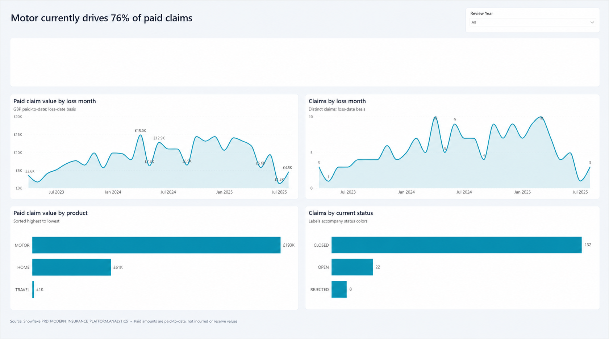

## 🧠 Design Principles

This platform is built using modern data engineering best practices:

- **Layered Architecture**
  - RAW → CLEAN → ANALYTICS separation
- **Incremental Processing**
  - Snowflake Streams + Tasks for change data capture
- **Transformation Framework**
  - dbt for modular, testable transformations
- **Infrastructure as Code**
  - Terraform manages Snowflake resources and RAW layer
- **Security & Governance**
  - Role-based access control (RBAC)
- **Environment Separation**
  - DEV and PRD databases for safe deployment

## 📁 Project Layout

- `dbt/` contains the dbt project, including `dbt_project.yml`, models, macros, seeds, snapshots, analyses, tests, package files, and dbt-generated artifacts.
- `terraform/` contains Snowflake infrastructure as code.
- `setup/` contains Snowflake SQL setup and seed scripts.
- `apps/` contains the Snowflake Streamlit application.
- `powerbi/` contains the file-based Power BI claims leadership scorecard, its
  local semantic model, PBIR report definition, and reproducible generator.

## 🔐 Roles & Responsibilities

| Role            | Access Level |
|-----------------|-------------|
| ROLE_LOADER     | Insert into RAW |
| ROLE_TRANSFORM  | Full access to CLEAN & ANALYTICS |
| ROLE_ANALYST    | Read-only access to ANALYTICS |

## ⚙️ Tech Stack

- Git (Source Control)
- Snowflake (Data Platform)
- dbt (Transformations)
- Terraform (Infrastructure)
- SQL / Python
- Power BI Desktop and PBIP/PBIR


## 🧪 Running the Project End-to-End

## ✅ Prerequisites

Before running the project locally, install:

- Git
- Terraform
- Python 3.10+
- dbt Core with the Snowflake adapter
- A Snowflake account
- Power BI Desktop for Windows, with the Snowflake connector available

### Install Git

Ubuntu / WSL:
`sudo apt update && sudo apt install -y git`

macOS:
`brew install git`

Check:
`git --version`

### Install Terraform

Ubuntu / WSL:

```bash
sudo apt update && sudo apt install -y wget gpg lsb-release
wget -O- https://apt.releases.hashicorp.com/gpg | \
gpg --dearmor | \
sudo tee /usr/share/keyrings/hashicorp-archive-keyring.gpg > /dev/null
echo "deb [signed-by=/usr/share/keyrings/hashicorp-archive-keyring.gpg] \
https://apt.releases.hashicorp.com $(lsb_release -cs) main" | \
sudo tee /etc/apt/sources.list.d/hashicorp.list
sudo apt update && sudo apt install -y terraform
```

macOS:
`brew tap hashicorp/tap && brew install hashicorp/tap/terraform`

Check:
`terraform --version`

### Install Python And dbt

Install Python 3.10+ first:

Ubuntu / WSL:
`sudo apt update && sudo apt install -y python3 python3-venv python3-pip`

macOS:
`brew install python@3.10`

Check:
`python3 --version`

Then create a virtual environment and install dbt:

```bash
python3 -m venv venv
source venv/bin/activate
pip install --upgrade pip
pip install dbt-core dbt-snowflake
```

Check:
`dbt --version`

## 🔐 Snowflake Setup

Create a free Snowflake account if you don't already have an account

https://signup.snowflake.com/

### Demo Security Note

This project is intentionally set up to be easy to bootstrap locally, so the examples below use password authentication, `ACCOUNTADMIN`, and grant the project roles to a single configured user. That keeps the setup simple for a portfolio/demo project and makes it easy to switch roles while loading data and running transformations.

In a more production-oriented implementation, I would tighten this considerably by separating bootstrap/admin access from runtime roles, avoiding broad admin use for dbt execution, reducing destructive privileges in production paths, and using stronger credential handling such as key-pair auth, OAuth, or secret management.

Then gather:

snowflake_organization_name  = "YOUR_SNOWFLAKE_ORG_NAME"
snowflake_account_name       = "YOUR_SNOWFLAKE_ACCOUNT_NAME"
snowflake_user               = "YOUR_SNOWFLAKE_USER"
snowflake_password           = "YOUR_SNOWFLAKE_PASSWORD"
snowflake_role               = "ACCOUNTADMIN"

You can find your account identifier in Snowsight:
Admin → Accounts → Locator

### 0. Clone Repository

git clone https://github.com/gwhitnell/modern-insurance-platform.git

cd modern-insurance-platform

### 1. Deploy Infrastructure

cd terraform

Copy terraform.tfvars.example → terraform.tfvars

cp terraform.tfvars.example terraform.tfvars

Update with your snowflake credentials and save

terraform init

terraform apply 

answer 'yes' when prompted

`terraform apply` grants `ROLE_LOADER`, `ROLE_TRANSFORM`, and `ROLE_ANALYST` to the configured `snowflake_user`, so the setup scripts can switch roles without a separate manual grant step.

That single-user role assignment is a convenience for this demo project rather than the pattern I would recommend for a production deployment.

### 2. Load Sample Data
Run the scripts in /setup for dev step first in snowflake worksheets or snowsql:

- 02_seed_raw_data.sql

Additional info for when production promotion happens in setup/README.md

- 04_seed_prd_story_data.sql

### 3. Run Transformations

## dbt Execution Options

### Option 1: Local dbt
Run dbt locally using dbt-snowflake.

Create a local dbt profile at `~/.dbt/profiles.yml`.

This project uses the dbt profile name `modern_insurance_platform` from `dbt/dbt_project.yml`, so your local `profiles.yml` must contain a matching entry.

Example:

```yaml
modern_insurance_platform:
  outputs:
    dev:
      type: snowflake
      account: YOUR_ACCOUNT_IDENTIFIER
      user: YOUR_USERNAME
      password: YOUR_PASSWORD
      role: ACCOUNTADMIN
      warehouse: MODERN_INSURANCE_PLATFORM_WH
      database: DEV_MODERN_INSURANCE_PLATFORM
      schema: DBT
      threads: 4
    prd:
      type: snowflake
      account: YOUR_ACCOUNT_IDENTIFIER
      user: YOUR_USERNAME
      password: YOUR_PASSWORD
      role: ACCOUNTADMIN
      warehouse: MODERN_INSURANCE_PLATFORM_WH
      database: PRD_MODERN_INSURANCE_PLATFORM
      schema: DBT
      threads: 4
  target: dev
```

How to use it:

From the repository root, ensure the virtual environment is activated:

source venv/bin/activate

cd dbt/

- `dbt debug` uses the default target from `target: dev`
- `dbt deps` builds dependencies
- `dbt run --full-refresh` builds into `DEV_MODERN_INSURANCE_PLATFORM`
- `dbt test` runs tests

Ensure you are happy development has run successfully before moving on to production, ensure data setup/ has been run for production

- `dbt run --target prd --full-refresh` builds into `PRD_MODERN_INSURANCE_PLATFORM`
- `dbt test --target prd` runs tests against PRD

### Option 2: Snowflake Native dbt (Recommended) -- there are some limitations to trial account because external access is disabled

Run dbt directly in Snowflake using Snowsight:

1. Go to My Worksheets → My Workspace → From Git repository
2. Connect to this repository (May need API integration in snowflake)
3. Configure environment
4. Run models

### 4. Validate Outputs

RAW:
SELECT COUNT(*) FROM RAW.BUSINESS_EVENTS;

CLEAN:
SELECT COUNT(*) FROM CLEAN.STG_BUSINESS_EVENTS;

ANALYTICS:
SELECT * FROM ANALYTICS.FCT_BUSINESS_EVENTS;

## Customer Service Search App

To showcase streamlit app interactivity

This repo includes a Snowflake-native Streamlit app for customer service users
to search for customers, policies, and claims using verified customer details.

Run it after Terraform, PRD seed data, and the PRD dbt build are complete:

1. Create the app schema and stage:
   `setup/06_streamlit_customer_service_search.sql`

2. Upload `apps/customer_service_search.py` to:
   `@PRD_MODERN_INSURANCE_PLATFORM.APP.STREAMLIT_STAGE/customer_service_search`

3. Create the Streamlit object:
   `setup/07_create_streamlit_customer_service_search.sql`

4. In Snowsight, switch to `ROLE_ANALYST`, open Streamlit, and select:
   `Customer Service Search`

The app runs inside Snowflake and uses the PRD `ANALYTICS` marts by default.

## Power BI Claims Leadership Scorecard

The repository includes a one-page Power BI leadership scorecard that connects
to the production Snowflake analytics marts in Import mode. It is stored as a
Power BI Project (`PBIP`) so the semantic model, report definition, visuals,
theme, and DAX remain visible and source-control friendly.

The scorecard includes:

- Total claims, total paid, average paid per claim, open claims, closure rate,
  and average reporting lag
- Paid claim value and claim volume by loss month
- Paid claim value by insurance product
- Claim counts by current status
- A review-year slicer and an accessible Corporate Cool theme



Paid values are paid-to-date. The current mart does not contain incurred loss or
outstanding reserves, so the report deliberately avoids presenting paid value as
either of those measures.

### Prerequisites

Before opening the report, complete the PRD seed and dbt build so these objects
exist:

```text
PRD_MODERN_INSURANCE_PLATFORM.ANALYTICS.FCT_CLAIMS
PRD_MODERN_INSURANCE_PLATFORM.ANALYTICS.DIM_POLICY
```

You also need:

- Power BI Desktop on Windows
- Network access to your Snowflake account
- A Snowflake user with read access to the PRD `ANALYTICS` schema and usage on
  `MODERN_INSURANCE_PLATFORM_WH`

### Open and refresh the report

1. Copy or clone the complete repository onto Windows. Keep the `.Report` and
   `.SemanticModel` folders beside the `.pbip` file; the relative path between
   them is required.
2. Open:
   `powerbi/ClaimsLeadershipScorecard/ClaimsLeadershipScorecard.pbip`
3. If prompted, confirm the semantic-model parameters:

   | Parameter | Default |
   |---|---|
   | `SnowflakeServer` | `DBSKDCV-OV11805.snowflakecomputing.com` |
   | `SnowflakeWarehouse` | `MODERN_INSURANCE_PLATFORM_WH` |
   | `SnowflakeDatabase` | `PRD_MODERN_INSURANCE_PLATFORM` |
   | `SnowflakeSchema` | `ANALYTICS` |

   Change `SnowflakeServer` when running the project in another Snowflake
   account.
4. In Power BI Desktop, choose **Transform data → Data source settings** and
   authenticate to Snowflake. Credentials are intentionally excluded from the
   project files.
5. Select **Refresh** and allow the `Claims`, `Policy`, and `Date` tables to
   load.
6. Confirm the KPI cards and four charts contain data, then save the project.

For the repository's seeded PRD data, the unfiltered validation totals are 162
claims, £255,050 paid, 22 open claims, an 81.5% closure rate, and a 4.1-day
average reporting lag. These figures are useful for checking an initial refresh
but will change when the sample data is extended.

### Regenerate and validate the PBIR files

The deterministic generator is:

```text
powerbi/generate-claims-scorecard.mjs
```

It requires Node.js 20 or later and the Microsoft Power BI report-authoring
CLI. From the repository root:

```bash
npm install -g @microsoft/powerbi-report-authoring-cli@latest
node powerbi/generate-claims-scorecard.mjs
powerbi-report-author validate \
  powerbi/ClaimsLeadershipScorecard/ClaimsLeadershipScorecard.Report
```

Regeneration replaces the generated report/model files, so make design changes
in the generator when they need to remain reproducible. Power BI Desktop is
still required for the final refresh and rendered visual review.
